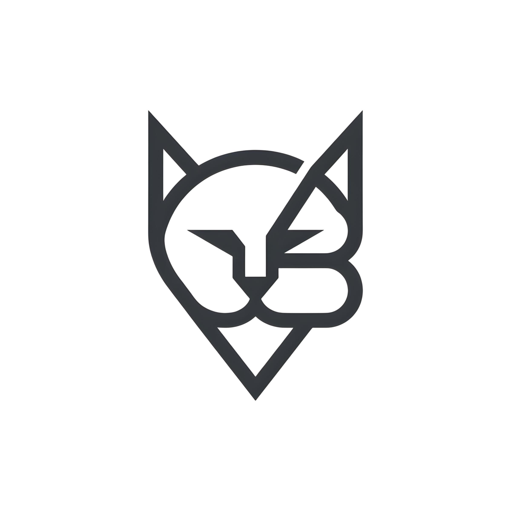

# CatByte — Pencil & Paper Sketch Edition

<p align="center">
  
</p>

A video editor built with **Jetpack Compose** and **Kotlin**, featuring a hand-drawn sketchbook aesthetic. Designed for short-form creators (Reels, Shorts, TikTok) who want a tactile, pencil-on-paper editing experience.

---

## ✨ Features

### Core Editing
- **Multi-track timeline** with video, audio, text, stickers, and effects
- **Aspect ratios**: 9:16 (Shorts/Reels), 16:9 (YouTube), 1:1 (Square), 4:5 (Portrait)
- **Paper textures**: Drafting Grid, Ruled Notebook, Blank Parchment, Sepia Kraft
- **13 artistic filters**: Graphite, Blueprint, Sepia, Charcoal, Manga Dots, Cyberpunk, Vintage, Golden Hour, Noir, Teal/Orange, Moody, Glitch Art
- **Transitions**: Cut, Fade, Slide, Push, Wipe, Spin, Glitch, Ink Bleed
- **Text animations**: Typewriter, Pop-up, Neon Pulse, Fade, Slide, Bounce
- **Speed ramping** (velocity curves) and clip adjustments (brightness, contrast, saturation, vignette)

### P1 UX & Functionality
- **Home screen**: Saveable tab/filter/dialog state, delete confirmation with a 5-second Undo bar, honest quick-tool Toasts, real profile stats
- **Settings popup**: Opens as a modal popup over the current screen (tap outside or press back to dismiss) with theme, language (System / English / বাংলা), cache size/clear, default export quality, watermark toggle, and version info
- **Export dialog**: Saveable resolution/FPS, defaults from Settings, watermark preview, Cancel during export, honest share messaging
- **Editor**: Fixed 175 dp timeline, runtime `RECORD_AUDIO` permission flow

### P2 Code Quality
- **DataStore Preferences** for persistent settings (theme, resolution, FPS, grid, watermark, language)
- **Manual DI**: `CatByteApplication` → `AppContainer` → `EditorViewModelFactory`
- **Locale handling** via `attachBaseContext` + `LocaleUtils` (works on all API levels)
- **CacheManager** for real cache reporting/clearing (includes Coil disk cache)
- **Test compatibility**: `EditorViewModel(repository)` constructor preserved for existing unit tests

### P3 Polish
- **Bengali (bn) localization** for key settings and home strings
- **Platform splash screen** (API 31+) with sketchbook branding
- **Adaptive icon** with monochrome support
- **Manifest**: `enableOnBackInvokedCallback`, `localeConfig`, `configChanges="...|locale"`

### System Logs (Debugging)
- **Real crash and error capture** through an uncaught-exception handler
- **Persistent log file** (`filesDir/logs/catbyte.log`) so reports survive a crash or restart
- **Searchable, filterable log list** with level badges, saved-session markers, and expandable stack traces
- **Copy all / copy single entry** and **download as `.txt`** through the Storage Access Framework (no storage permission required)
- **Clear logs** with a confirmation dialog

No demo template catalogue is bundled. The app focuses on the user's own projects and imported footage.

---

## 🏗 Architecture

```
app/
├── data/
│   ├── AppLanguage.kt          # SYSTEM | ENGLISH | BENGALI
│   ├── AppContainer.kt         # Manual DI container
│   ├── AppLog.kt               # Ring buffer, file persistence, crash handler
│   ├── CacheManager.kt         # Cache size + clear
│   ├── LocaleUtils.kt          # Per-app locale via attachBaseContext
│   ├── ProjectRepository.kt    # In-memory project CRUD + restore
│   └── SettingsRepository.kt   # DataStore persistence
├── ui/
│   ├── components/
│   │   ├── VideoCanvas.kt      # Preview with pulse, watermark, placeholders
│   │   ├── ExportDialog.kt     # Standalone export sheet
│   │   └── MultiTrackTimeline.kt
│   └── screens/
│       ├── HomeScreen.kt       # Drafts, inbox, profile
│       ├── EditorScreen.kt     # Timeline + canvas + tool sheets
│       ├── SettingsScreen.kt   # Settings content hosted in a modal popup
│       └── SystemLogsScreen.kt # Crash/error viewer, copy and download
├── viewmodel/
│   ├── EditorViewModel.kt      # Core editing state + settings bridge
│   └── EditorViewModelFactory.kt
├── CatByteApplication.kt       # App entry + logging + DI init
└── MainActivity.kt             # Screen nav, settings popup, locale wrap
```

---

## 🚀 Build & Run

```bash
# Requires JDK 17+ and Android SDK 36
./gradlew :app:assembleDebug --offline

# Run unit tests
./gradlew :app:testDebugUnitTest --tests "com.example.ExampleUnitTest" --offline
```

**Output**: `app/build/outputs/apk/debug/app-debug.apk`

---

## 📦 Dependencies (Key)

| Library | Version |
|---------|---------|
| Compose BOM | 2025.01.01 |
| Kotlin | 2.2.10 |
| Android Gradle Plugin | 9.5.0 |
| DataStore Preferences | 1.3.0 |
| Coil Compose | 2.7.0 |
| Lifecycle / ViewModel / Compose | 2.8.7 |
| Activity Compose | 1.10.1 |
| Media3 (ExoPlayer / Transformer) | 1.11.1 |

---

## 🎯 Scope Notes

**Implemented (P1–P3):**
- All UX flows, settings popup, export dialog, localization, splash, DI, DataStore, cache, system logs, tests

**Out of Scope or Partial:**
- Not every creative filter/effect is burned into exported video yet; the UI does not claim otherwise
- Release signing cleanup (keystore env vars remain)
- Room persistence for projects (in-memory only)
- Full string localization (~300 hardcoded strings remain in UI code)

---

## 📄 License

MIT — see [LICENSE](LICENSE)
